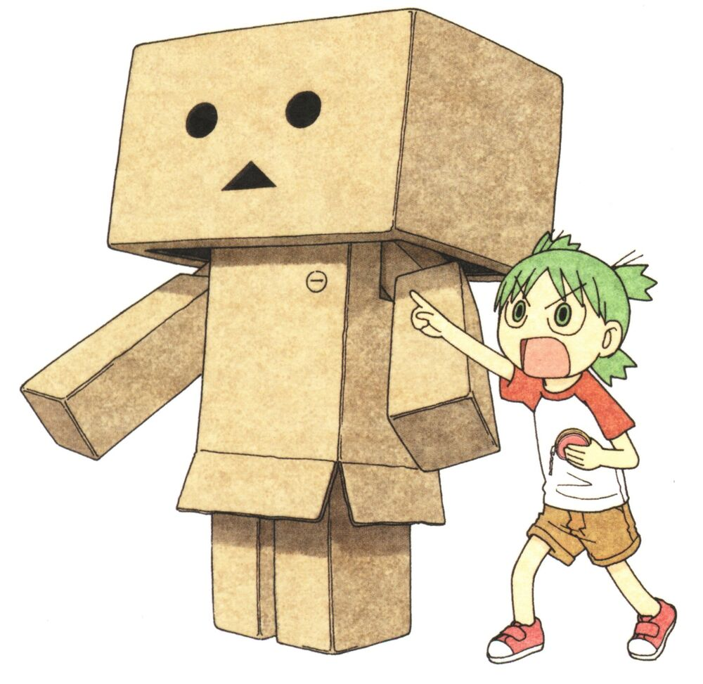

# yotsubar 🍀

<table>
  <tr>
    <td width="25%" align="left" valign="top">
      
    </td>
    <td width="75%" align="left" valign="top">
      <strong>A time budget tracker</strong> 
      <em>that lives in your GNOME top bar</em>
      
Give each part of your day its time. Yotsubar keeps the balance visible and gives you a gentle nudge when time is up.

    </td>
  </tr>
</table>

🚧 Early development.
